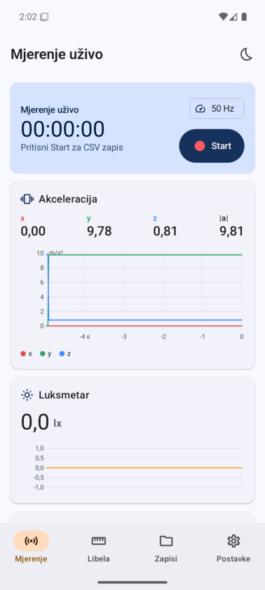
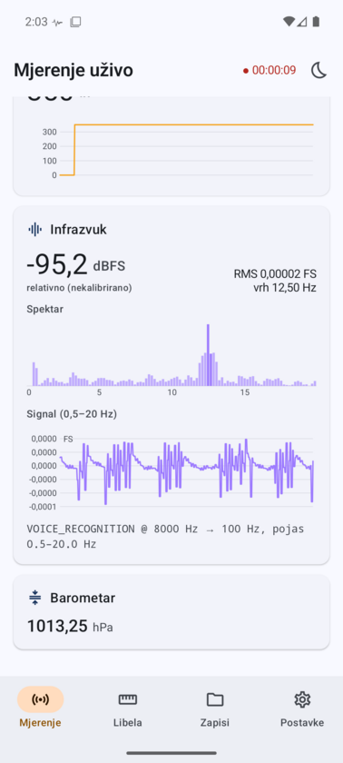
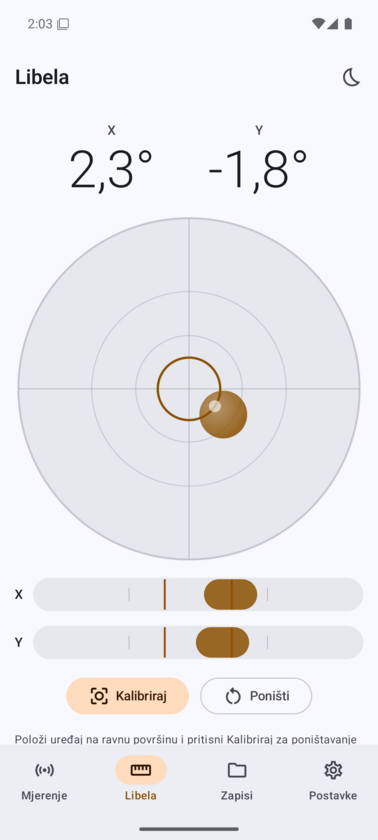
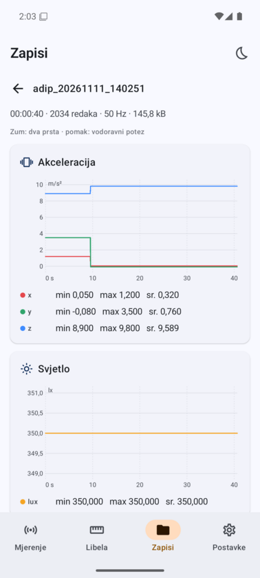
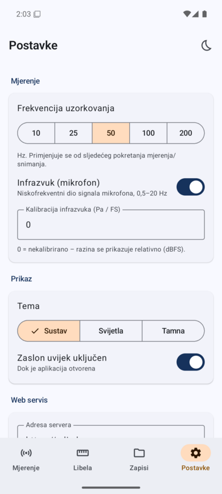
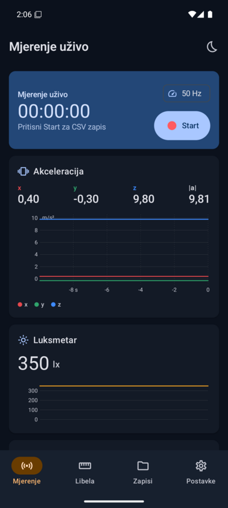
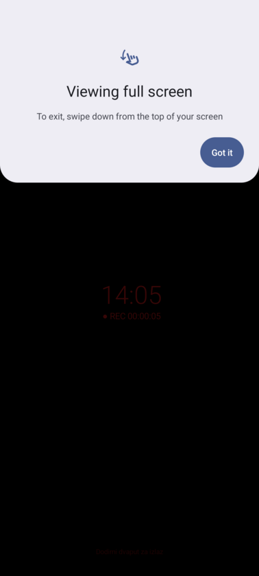
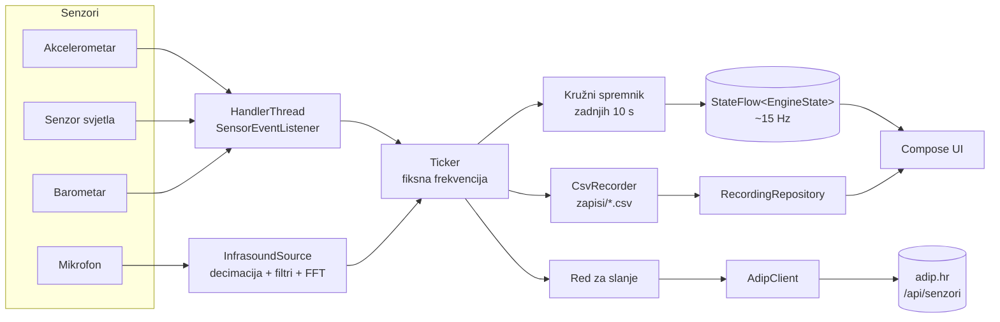
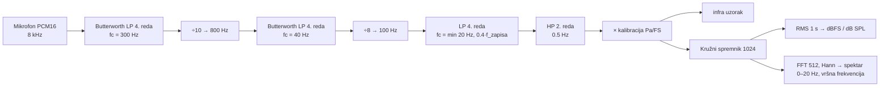

# ADIP Senzori

Android aplikacija Astronomskog društva "Istra" Pula. Pretvara mobitel u mali mjerni instrument:

- mjeri **akceleraciju u tri osi**, **osvjetljenje (luksmetar)**, **infrazvuk** i **tlak zraka** (ako uređaj ima barometar);
- sve senzore uzorkuje **fiksnom frekvencijom** koja se bira u postavkama;
- **snima zapise u CSV** na uređaj i kasnije ih prikazuje u grafovima;
- **šalje podatke na web servis** na [adip.hr](https://adip.hr): uživo tijekom snimanja ili cijeli zapis naknadno;
- ima **libelu** za postavljanje mobitela u vodoravan položaj prije mjerenja;
- ima **svijetlu i tamnu temu** te **noćni način**: crni ekran na minimalnoj svjetlini, dok mjerenje teče dalje.

| Mjerenje | Infrazvuk | Libela | Zapis | Postavke | Tamna tema | Noćni način |
|---|---|---|---|---|---|---|
|  |  |  |  |  |  |  |

Repozitorij sadrži aplikaciju (`app/`) i serverski modul (`server/`), koji je ugrađen u adip-web i radi na produkciji.

---

## Sadržaj

1. [Brzi početak](#brzi-početak)
2. [Arhitektura](#arhitektura)
3. [Mjerenje i uzorkovanje](#mjerenje-i-uzorkovanje)
4. [Infrazvuk](#infrazvuk)
5. [Snimanje u CSV](#snimanje-u-csv)
6. [Web servis (adip.hr)](#web-servis-adiphr)
7. [Ekrani aplikacije](#ekrani-aplikacije)
8. [Postavke](#postavke)
9. [Dozvole](#dozvole)
10. [Struktura projekta](#struktura-projekta)
11. [Ograničenja i daljnji rad](#ograničenja-i-daljnji-rad)

---

## Brzi početak

### Alati

Projekt ne traži Android Studio. Dovoljni su:

| Alat | Lokacija | Napomena |
|---|---|---|
| JDK 21 (Temurin) | `~/.local/jdks/21` | Za Gradle i AGP |
| Android SDK | `~/Android/Sdk` | platform-36, build-tools 36.1, platform-tools, emulator |
| Emulator AVD | `adip_pixel` | Pixel 7, Android 16 (API 36), x86_64, KVM |

Skripta `env.sh` postavlja `JAVA_HOME`, `ANDROID_HOME` i `PATH`:

```bash
cd adip-senzori
source env.sh
```

### Build i pokretanje

```bash
./gradlew assembleDebug                    # APK: app/build/outputs/apk/debug/app-debug.apk
emulator -avd adip_pixel &                 # pokreni emulator
adb install -r app/build/outputs/apk/debug/app-debug.apk
adb shell am start -n hr.adip.senzori/.MainActivity
```

Na pravom mobitelu uključi *Opcije za razvojne programere → USB otklanjanje pogrešaka*, spoji ga kabelom i pokreni isti `adb install`.

Senzore u emulatoru mijenjaš u *Extended controls (⋯) → Virtual sensors* (akceleracija, svjetlo, tlak). Mikrofon emulatora prima zvuk s mikrofona računala ako je u *Extended controls → Microphone* uključeno "Virtual microphone uses host audio input".

### Tehnologije

- Kotlin 2.3, Jetpack Compose (Material 3), AGP 9, Gradle 9.1
- `minSdk 26` (Android 8.0), `targetSdk 36`
- Bez vanjskih biblioteka za grafove i mrežu: grafovi su nacrtani na Compose `Canvas`, mreža ide preko `HttpURLConnection`
- DataStore Preferences za postavke

---

## Arhitektura



### Glavne komponente

| Komponenta | Datoteka | Uloga |
|---|---|---|
| `AdipApp` | `AdipApp.kt` | `Application`, drži jedinstvene instance svih servisa |
| `SensorEngine` | `sensor/SensorEngine.kt` | Registrira senzore, uzorkuje fiksnom frekvencijom, vodi snimanje i slanje uživo |
| `InfrasoundSource` | `sensor/InfrasoundSource.kt` | Čita mikrofon, decimira, filtrira, računa RMS, razinu i spektar |
| `Dsp` | `sensor/Dsp.kt` | Biquad/Butterworth filtri, decimator, FFT |
| `MeasurementService` | `service/MeasurementService.kt` | Foreground servis i wake lock, da snimanje radi i kad je ekran ugašen |
| `CsvRecorder`, `RecordingRepository` | `recording/Recording.kt` | Pisanje, popis, učitavanje, brisanje i dijeljenje CSV zapisa |
| `AdipClient` | `upload/AdipClient.kt` | HTTP klijent za `/api/senzori` |
| `SettingsRepository` | `data/Settings.kt` | Postavke (DataStore) |
| UI | `ui/…` | Ekrani Mjerenje, Libela, Zapisi, Postavke te noćni način |

Engine postoji jednom za cijelu aplikaciju i ne ovisi o tome koji je ekran otvoren. UI samo čita `engine.state` (`StateFlow<EngineState>`) i poziva `start()`, `stop()`, `startRecording()` i `stopRecording()`.

---

## Mjerenje i uzorkovanje

### Fiksna frekvencija

Frekvencija zapisa bira se u postavkama: **10, 25, 50 (zadano), 100 ili 200 Hz**. Primjenjuje se pri sljedećem pokretanju mjerenja. Za vrijeme snimanja se ne mijenja, jer cijeli zapis mora imati istu frekvenciju.

Android senzori ne isporučuju podatke točno zadanom frekvencijom: događaji kasne, dolaze u naletima i razlikuju se od uređaja do uređaja. Zato engine razdvaja **prikupljanje** od **uzorkovanja**:

1. **Prikupljanje.** `SensorEventListener` na zasebnoj `HandlerThread` prima događaje:
   - akcelerometar se traži barem 4× brže od frekvencije zapisa i sva očitanja se zbrajaju;
   - svjetlo i tlak pamte zadnju vrijednost;
   - iz akceleracije se niskopropusnim filtrom (α = 0.1) računa i vektor gravitacije za libelu.
2. **Uzorkovanje.** Korutina *ticker* budi se u trenucima `t0 + n·T`, mjereno monotonim satom `elapsedRealtimeNanos`, i iz trenutnog stanja složi jedan `Sample`:
   - **akceleracija** je *prosjek* svih očitanja u intervalu, što služi kao jednostavni anti-aliasing (boxcar) filtar;
   - **svjetlo, tlak i infrazvuk** su zadnja poznata vrijednost (sample-and-hold).
3. **Vremenska oznaka** svakog uzorka je `t0_wall + n·T` u milisekundama. Redovi u CSV-u su zato točno ekvidistantni, bez jittera. Kad sustav zakasni, ticker sustigne propušteno.

Isti uzorak ide na tri mjesta: u kružni spremnik zadnjih 10 s (grafovi uživo), u CSV kad se snima i u red za slanje kad je uključeno slanje uživo.

### Jedinice

| Kanal | Jedinica | Izvor |
|---|---|---|
| `ax`, `ay`, `az` | m/s², uključuje gravitaciju | `TYPE_ACCELEROMETER` |
| `lux` | lx | `TYPE_LIGHT` |
| `infra` | relativne jedinice punog raspona (FS) ili Pa ako je kalibrirano | mikrofon |
| `p_hpa` | hPa | `TYPE_PRESSURE` |

Osi su osi uređaja: **x** prema desnom rubu ekrana, **y** prema vrhu ekrana, **z** iz ekrana prema korisniku. Mobitel koji leži na stolu ekranom prema gore pokazuje `az ≈ +9.81`.

---

## Infrazvuk

Infrazvuk je zvuk ispod granice čujnosti, **< 20 Hz**. Prirodni izvori su meteori i bolidi, oluje, valovi, vjetar oko planina, potresi i vulkani. Umjetni su eksplozije, vjetroelektrane, promet i industrija. Pri astronomskim promatranjima posebno su zanimljivi **bolidi**: njihov udarni val putuje stotinama kilometara kao infrazvuk.

### Može li to mobitel?

Djelomično. Istraživanja pokazuju da se mikrofoni pametnih telefona mogu koristiti za infrazvuk. Primjer je aplikacija RedVox Infrasound Recorder (University of Hawai'i), korištena i na balonskim letovima i za praćenje eksplozija. Ograničenja su ova:

- **Mikrofon ima visokopropusni filtar.** MEMS mikrofoni imaju malu ventilacijsku rupicu za izjednačavanje tlaka, a audio lanac često dodaje i DC/HPF filtar. Osjetljivost zato pada ispod otprilike 10–20 Hz, a ispod ~1 Hz je vrlo mala. Signal je i dalje mjerljiv, samo prigušen.
- **Softverska obrada.** AGC, potiskivanje šuma i "voice" filtri iskrivljuju signal. Zato aplikacija bira izvor `UNPROCESSED` kad ga uređaj podržava (`AudioManager.PROPERTY_SUPPORT_AUDIO_SOURCE_UNPROCESSED`), a inače `VOICE_RECOGNITION`, koji po Android CDD-u ima minimalnu obradu.
- **Bez kalibracije vrijednosti su relativne.** Apsolutni tlak u Pa zahtijeva usporedbu s referentnim mikrobarometrom i unos faktora u postavke.
- **Vjetar** stvara jak lažni infrazvuk. Za ozbiljna mjerenja mobitel treba biti u zatvorenom ili zaštićen od vjetra.
- **Barometar** (`p_hpa`) dopunjuje mikrofon u najnižem pojasu (≲ 1 Hz), ali je spor (obično 10–25 Hz) i ima ograničenu rezoluciju. Aplikacija ga bilježi kao zaseban kanal.

### Obrada signala



1. **Snimanje.** `AudioRecord`, mono PCM16, redom se probaju frekvencije 8000, 16000, 48000 i 44100 Hz. 8 kHz je najmanje opterećenje i ista je frekvencija koju koristi RedVox.
2. **Dvostupanjska decimacija na oko 100 Hz.** Svaki stupanj ima Butterworth niskopropusni filtar 4. reda (dva biquada, Q = 0.541 i 1.307) prije uzimanja svakog N-tog uzorka. To sprječava aliasing: čujni zvukovi poput govora i glazbe ne mogu se "preklopiti" u infrazvučni pojas. Filtri rade u `double` preciznosti, jer je omjer fc/fs vrlo mali.
3. **Pojasni filtar 0.5 Hz – fc.** Gornja granica je 20 Hz, ali najviše 0.4 × frekvencija zapisa. Pri zapisu od 25 Hz granica je 10 Hz, da i CSV bude bez aliasinga. Visokopropusni filtar na 0.5 Hz uklanja DC i spori drift.
4. **Zagrijavanje.** Prve 3 s izlaza se odbacuju, dok se filtri ne smire.
5. **Analiza svakih 250 ms:**
   - RMS zadnje sekunde;
   - razina u **dBFS** (nekalibrirano) ili **dB SPL re 20 µPa** (kalibrirano);
   - amplitudni spektar (FFT, 512 točaka pri ~100 Hz, dakle rezolucija ≈ 0.2 Hz, Hann prozor), normaliziran za prikaz;
   - **dominantna frekvencija** u pojasu 0.5–20 Hz.

Status izvora vidi se u aplikaciji i zapisuje u CSV, npr. `UNPROCESSED @ 8000 Hz → 100 Hz, pojas 0.5–20.0 Hz`.

### Kalibracija

U postavkama se unosi faktor **Pa po jedinici punog raspona (Pa/FS)**. Vrijednost `0` znači nekalibrirano. Postupak:

1. Postavi mobitel uz referentni mikrobarometar ili kalibrirani infrazvučni senzor.
2. Snimi isti signal na oba, npr. zatvaranje vrata ili niskofrekventni zvučnik na 5–10 Hz.
3. Faktor = RMS reference [Pa] / RMS iz aplikacije [FS], za isti pojas.

Faktor vrijedi samo za taj model mobitela i samo približno, jer odziv nije ravan po frekvenciji.

---

## Snimanje u CSV

### Kako snimanje radi

- Gumb **Snimaj** na ekranu *Mjerenje* pokreće `MeasurementService`, **foreground servis** s trajnom obavijesti, štopericom i gumbom *Zaustavi*.
  - Servis drži `PARTIAL_WAKE_LOCK`, pa uzorkovanje teče i s ugašenim ekranom i u noćnom načinu.
  - Tip servisa je `microphone` ako je dozvola za mikrofon odobrena, inače `dataSync`.
- Dok traje snimanje, engine ignorira zahtjeve za zaustavljanje mjerenja i promjene frekvencije.
- Datoteka se puni kroz međuspremnik od 64 KB, koji se prazni na disk svake sekunde. Kod rušenja se gubi najviše oko 1 s podataka.

### Gdje se spremaju

```
/sdcard/Android/data/hr.adip.senzori/files/zapisi/adip_YYYYMMDD_HHMMSS.csv
```

To je mapa aplikacije, pa ne treba dozvola za pohranu. Na računalu je vidljiva preko USB-a (MTP) ili naredbom:

```bash
adb pull /sdcard/Android/data/hr.adip.senzori/files/zapisi/ .
```

Zapisi se mogu i **dijeliti** iz aplikacije (e-mail, Drive…) preko `FileProvider`.

### Format

```csv
# app=ADIP Senzori 1.0
# device=Google Pixel 7
# deviceId=3f2a9c…
# sessionId=adip_20261111_210501_3f2a9c1b
# startedAt=2026-11-11T20:05:01.123Z
# startedAtMs=1794427501123
# sampleRateHz=50
# units=t_ms=unix ms; a=m/s^2; lux=lx; infra=rel. FS; p_hpa=hPa
# infraSource=UNPROCESSED @ 8000 Hz → 100 Hz, pojas 0.5–20.0 Hz
# infraBand=0.5-20.0 Hz
t_ms,ax,ay,az,lux,infra,p_hpa
1794427501143,0.0123,0.0871,9.8012,312.0,1.52E-4,1013.21
1794427501163,0.0119,0.0866,9.8034,312.0,-3.1E-5,1013.21
…
```

- Redovi s `#` su metapodaci u obliku `ključ=vrijednost`. Pandas ih preskače s `comment="#"`, a Excel/LibreOffice ih prikaže kao tekst.
- Prazno polje znači da senzor nije dostupan (npr. `p_hpa` bez barometra, `infra` bez dozvole za mikrofon).
- Brojevi koriste decimalnu točku. Mali brojevi mogu biti u znanstvenom zapisu (`1.52E-4`).

Primjer u Pythonu:

```python
import pandas as pd
df = pd.read_csv("adip_20261111_210501.csv", comment="#")
df["t"] = pd.to_datetime(df.t_ms, unit="ms")
df.plot(x="t", y=["ax", "ay", "az"])
```

### Ponovni prikaz

Ekran *Zapisi* prikazuje popis zapisa s datumom, trajanjem, brojem redova, frekvencijom i veličinom. Na otvorenom zapisu vide se grafovi svih kanala, statistika (min, max, srednja vrijednost) i metapodaci.

Veliki zapisi se za graf **decimiraju min/max metodom**: svaki blok redova svodi se na svoj minimum i maksimum. Tako graf ostaje brz, a kratki vrhovi (udarci, impulsi) ne nestaju. Datoteka na disku se ne mijenja.

---

## Web servis (adip.hr)

Serverski dio je modul `server/senzori-api.js`, u adip-web ugrađen kao `senzori/server/senzori-api.js` jednom linijom u `server.js`:

```js
require('./senzori/server/senzori-api')(app);
```

Radi na produkciji: <https://adip.hr/api/senzori/status>. Detalji su u [`server/README.md`](server/README.md).

### API

Autentikacija ide zaglavljem `Authorization: Bearer <token>`. Samo `/status` radi bez tokena.

| Metoda | Ruta | Opis |
|---|---|---|
| GET | `/api/senzori/status` | `{ok, service, version, time}` |
| POST | `/api/senzori/batch` | Paket redova uživo (JSON, do 2 MB); prvi paket stvara sesiju, sljedeći se dodaju |
| POST | `/api/senzori/upload` | Cijeli CSV (multipart, polje `file`, do 50 MB); stvara sesiju ili je zamjenjuje |
| GET | `/api/senzori/sesije` | Popis sesija, najnovije prve |
| GET | `/api/senzori/sesije/:id?limit=N` | Metapodaci i zadnjih N redova kao JSON |
| GET | `/api/senzori/sesije/:id/csv` | Preuzimanje CSV-a |
| DELETE | `/api/senzori/sesije/:id` | Brisanje sesije |

Primjer paketa koji aplikacija šalje:

```json
{
  "sessionId": "adip_20261111_210501_3f2a9c1b",
  "deviceId": "3f2a9c…", "deviceModel": "Google Pixel 7", "appVersion": "1.0",
  "startedAt": "2026-11-11T20:05:01.123Z", "sampleRateHz": 50,
  "columns": ["t_ms","ax","ay","az","lux","infra","p_hpa"],
  "rows": [[1794427501143, 0.0123, 0.0871, 9.8012, 312.0, 0.000152, 1013.21], …]
}
```

Na serveru se svaka sesija sprema kao `data/senzori/<sessionId>.csv`, istog formata kao na mobitelu, a metapodaci u `data/senzori/index.json`. Deploy ne dira mapu `data/`, pa podaci prežive svaki deploy.

### Kako aplikacija šalje

**Uživo**, kad je u postavkama uključeno "Slanje uživo":

- Za vrijeme snimanja uzorci idu u red, a svakih *N* sekundi (postavka, zadano 5 s) šalje se paket od najviše 5000 redova na `/batch`.
- Ako slanje ne uspije (nema mreže, server nedostupan), redovi ostaju u redu i šalju se sljedeći put. Red ima najviše 200 000 redova; najstariji se odbacuju.
- Kad se snimanje zaustavi, šalje se ostatak reda.
- CSV na mobitelu se piše uvijek, neovisno o slanju. Server je kopija, ne zamjena.

**Naknadno:** na ekranu *Zapisi* odabire se zapis i "Pošalji na server", što šalje cijeli CSV multipartom na `/upload`. ID sesije je isti kao pri slanju uživo (`<ime_datoteke>_<prvih 8 znakova deviceId>`), pa naknadno slanje zamjenjuje nepotpunu sesiju iz slanja uživo.

**Provjera veze:** gumb "Testiraj vezu" u postavkama poziva `/status`, a zatim `/sesije` s tokenom. Tako javlja i radi li server i je li token ispravan.

`deviceId` je nasumični UUID generiran pri prvom pokretanju. Nije vezan uz hardver ni korisnika.

### Ugradnja u web stranicu (sljedeći korak)

API je spreman, ali na stranici još **nema prikaza** podataka. Kad bude trebao, dovoljna je statička stranica (npr. `servisi/senzori.html`) koja:

1. dohvati popis sesija s `GET /api/senzori/sesije`;
2. za odabranu sesiju periodično povlači `GET /api/senzori/sesije/:id?limit=3000` (za uživo, svakih nekoliko sekundi) i crta grafove;
3. nudi preuzimanje preko `/csv`.

Prije toga treba riješiti autentikaciju (vidi dolje).

---

## Ekrani aplikacije

Navigacija je donja traka s četiri kartice. Ikona mjeseca u gornjoj traci uključuje **noćni način** na svakom ekranu.

### Mjerenje

- **Akceleracija:** x, y, z i |a| u m/s² te graf zadnjih 10 s s tri krivulje.
- **Luksmetar:** velika vrijednost u lx i graf; "nije dostupno" ako uređaj nema senzor svjetla.
- **Infrazvuk:**
  - razina (dBFS ili dB SPL), RMS i dominantna frekvencija;
  - stupčasti spektar 0–20 Hz i vremenski graf;
  - status izvora i gumb za dozvolu mikrofona.
- **Barometar**, ako postoji.
- Gumb za **početak i kraj snimanja** s trajanjem, brojem redova i statusom slanja.

### Libela

- Iz vektora gravitacije računaju se nagibi: **pitch** (oko x osi) i **roll** (oko y osi).
- Kružna libela s mjehurićem, koji se miče suprotno od nagiba kao u pravoj libeli, plus dvije linearne libele za X i Y.
- Kutovi su ispisani u stupnjevima. Unutar ±0.5° na obje osi libela postaje zelena, uz kratku vibraciju.
- **Kalibriraj:** trenutni položaj se pamti kao nula. Korisno ako stol ili kućište mobitela nisu ravni: mobitel se postavi na referentnu ravnu površinu i pritisne gumb. **Poništi** briše kalibraciju.

### Zapisi

- Popis CSV zapisa. Akcije za svaki zapis su otvori, podijeli, pošalji na server i obriši (uz potvrdu).
- Detalj zapisa prikazuje grafove po kanalu, statistiku i metapodatke.

### Postavke

Opisane [u nastavku](#postavke).

### Noćni način

Za dugotrajna mjerenja noću, npr. u zvjezdarnici, gdje svijetli ekran smeta promatranju i troši bateriju:

- cijeli ekran postaje **potpuno crn**, što na OLED ekranima znači da pikseli ne svijetle;
- svjetlina ekrana pada na minimum, a sistemske trake se skrivaju;
- ekran ostaje upaljen; vide se samo mali tamnocrveni sat i indikator **● REC** s trajanjem, jer crvena najmanje smeta prilagodbi oka na mrak;
- **dvostruki dodir** izlazi iz noćnog načina i vraća svjetlinu;
- mjerenje i snimanje se pritom nastavljaju.

### Teme

Svijetla, tamna ili po sustavu (postavka). Paleta je tamnoplava "noćno nebo" s jantarnim naglaskom. Aplikacija je edge-to-edge.

---

## Postavke

| Postavka | Zadano | Opis |
|---|---|---|
| Frekvencija uzorkovanja | 50 Hz | 10 / 25 / 50 / 100 / 200 Hz; primjenjuje se pri sljedećem pokretanju |
| Infrazvuk | uključeno | Mjerenje mikrofonom |
| Kalibracija infrazvuka | 0 (nekalibrirano) | Pa po jedinici punog raspona |
| Tema | Sustav | Sustav / Svijetla / Tamna |
| Drži ekran upaljen | uključeno | `FLAG_KEEP_SCREEN_ON` dok je aplikacija otvorena |
| URL servisa | `https://adip.hr` | Osnovni URL web servisa |
| Token | prazno | Bearer token za `/api/senzori` |
| Slanje uživo | isključeno | Slanje paketa za vrijeme snimanja |
| Interval slanja | 5 s | Koliko se često šalje paket |
| Kalibracija libele | 0°, 0° | Postavlja se gumbom na ekranu Libela |

Postavke se spremaju u DataStore (`postavke.preferences_pb`).

---

## Dozvole

| Dozvola | Zašto |
|---|---|
| `RECORD_AUDIO` | Infrazvuk (traži se tek kad korisnik uključi infrazvuk) |
| `INTERNET`, `ACCESS_NETWORK_STATE` | Slanje na web servis |
| `HIGH_SAMPLING_RATE_SENSORS` | Akcelerometar brži od 200 Hz na Androidu 12+ (za zapis od 100–200 Hz s usrednjavanjem) |
| `FOREGROUND_SERVICE`, `…_MICROPHONE`, `…_DATA_SYNC` | Snimanje u pozadini |
| `POST_NOTIFICATIONS` | Obavijest o snimanju (Android 13+) |
| `WAKE_LOCK` | Uzorkovanje s ugašenim ekranom |
| `VIBRATE` | Kratka vibracija kad je libela ravna |

---

## Struktura projekta

```
adip-senzori/
├── README.md                 ← ovaj dokument
├── env.sh                    ← JDK + Android SDK varijable
├── app/
│   ├── build.gradle.kts
│   └── src/main/
│       ├── AndroidManifest.xml
│       ├── res/xml/file_paths.xml           (FileProvider)
│       └── kotlin/hr/adip/senzori/
│           ├── AdipApp.kt                   (Application, ovisnosti)
│           ├── MainActivity.kt
│           ├── data/Settings.kt             (AppSettings, SettingsRepository)
│           ├── sensor/
│           │   ├── EngineState.kt           (Sample, History, InfraInfo, EngineState)
│           │   ├── SensorEngine.kt          (uzorkovanje, snimanje, slanje uživo)
│           │   ├── InfrasoundSource.kt      (mikrofon → infrazvuk)
│           │   └── Dsp.kt                   (Biquad, Butterworth, Decimator, FFT)
│           ├── recording/Recording.kt       (CsvRecorder, RecordingRepository)
│           ├── upload/AdipClient.kt         (HTTP klijent)
│           ├── service/MeasurementService.kt(foreground servis)
│           └── ui/                          (Compose ekrani, grafovi, teme, noćni način)
└── server/                   ← modul za adip-web (Express)
    ├── senzori-api.js
    ├── test-senzori.js       (smoke test: node server/test-senzori.js)
    └── README.md
```

---

## Ograničenja i daljnji rad

- **Autentikacija:** servis trenutno koristi isti fiksni token kao admin panel adip-weba (`fake-jwt-token-adip`). Prije javne objave treba uvesti prave tokene, idealno token po uređaju s mogućnošću opoziva, i ograničiti brzinu zahtjeva.
- **Infrazvuk je relativan** bez kalibracije, a odziv mikrofona ispod ~10 Hz ovisi o modelu mobitela. Za znanstvenu upotrebu treba izmjeriti frekvencijski odziv svakog modela i uvesti korekcijski filtar.
- **Vremenska točnost:** vremenske oznake su idealne (`t0 + n·T`), ali `t0` dolazi iz sata mobitela. Za usporedbu više uređaja treba sinkronizirati sat (NTP/GPS) ili dodati GPS vrijeme.
- **Frekvencija od 200 Hz:** infrazvučni kanal se interno računa na ~100 Hz, pa se kod zapisa od 200 Hz svaka vrijednost ponavlja dvaput. Pojas do 20 Hz je i tako u potpunosti pokriven.
- **Prikaz na webu:** API je spreman, stranica za pregled podataka još nije napravljena.
- **Mogući dodaci:** GPS lokacija u metapodacima, žiroskop i magnetometar, okidač snimanja na prag (npr. bolid), automatsko slanje zapisa kad se pojavi Wi-Fi.
